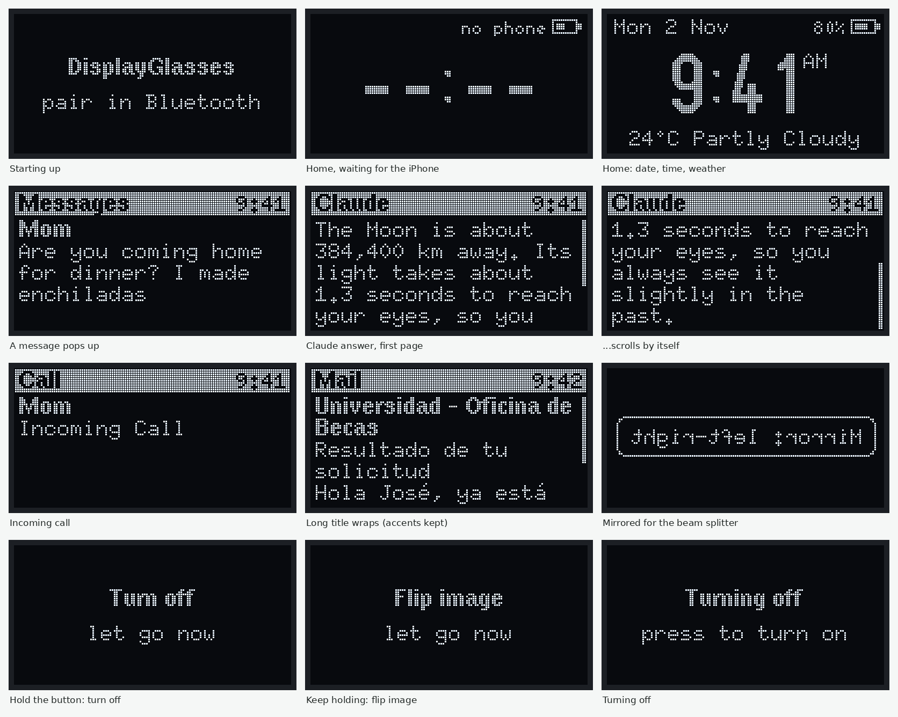

# DisplayGlasses

[](https://github.com/root47-alt/DisplayGlasses/actions/workflows/build.yml)

DIY smart glasses with a small display in front of one eye that only you can see. They show your iPhone notifications, the time, the weather, and answers from Claude, with the text floating over the real world.

## How it works

Your eye can't focus on a screen 2 cm away, so the glasses use two optical tricks:

- A **lens** makes the tiny OLED screen look like it's floating out in front of you, where your eye can focus on it.
- A **beam splitter** (see-through glass at 45°, partly mirrored) bounces that image into your eye while you still see the world through it.

```
       world
         |
         v
         / <---- () <---- [OLED]
         |       lens
         v
        eye       / = beam splitter
```

OLED black pixels give off no light, so only the text shows up. The reflection mirrors the image; a long press on the button flips it back.

### Glasses ↔ iPhone

The glasses pair with your iPhone over Bluetooth like a smartwatch does, using two services built into iOS. **No iPhone app to build or install.**

| Feature | Where it comes from |
|---|---|
| Notifications | iOS shares every notification over Bluetooth (Apple Notification Center Service) |
| Time | iOS shares its clock over Bluetooth (Current Time Service) |
| Weather | A Shortcuts automation posts a "Weather" notification; the glasses put it on the home screen |
| Claude answers | An "Ask Claude" shortcut: you speak, Claude answers, the answer appears in the glasses |
| Claude Code sessions | The Claude app's notifications (session finished, needs your input) show up like any other notification |

Setup steps for all of this are in [docs/iphone-setup.md](docs/iphone-setup.md).

## What it looks like

Drawn by the real firmware code in the [screen simulator](tools/hudsim/README.md):



## Hardware (no soldering)

An Adafruit ESP32 Feather (Bluetooth, battery charger), a 0.96" 128×64 OLED that plugs in with a cable, a small LiPo battery, a 30 mm lens and a thin beam splitter, all held by 3D-printed parts. Full list with links and prices: [docs/parts-list.md](docs/parts-list.md).

## Tools

- **[Browser flasher](https://root47-alt.github.io/DisplayGlasses/flash/):** install the firmware from Chrome, no setup.
- **[Optics calculator](https://root47-alt.github.io/DisplayGlasses/optics/):** try lenses and beam splitters before buying ([source](tools/optics/README.md)).
- **[Screen simulator](tools/hudsim/README.md):** runs the real screen code on a computer, for pictures and tests.

## What's in this repo

```
firmware/   ESP32 code (C++, PlatformIO): screen, button, iPhone Bluetooth link
  lib/core/   pure logic with unit tests (text wrapping, clock, notification protocol)
  src/        hardware code
docs/       parts list, iPhone setup, optics guide
cad/        3D-printable parts (OpenSCAD source and ready-to-print STLs)
tools/      optics calculator, screen simulator and screen tests
web/        the project website: browser flasher and home page
```

## Getting started

1. **Order the parts:** [docs/parts-list.md](docs/parts-list.md)
2. **See it before the parts arrive:** the [screens](docs/images/screens/overview.png), or run the demo in the Wokwi simulator ([firmware/README.md](firmware/README.md#try-it-in-the-simulator))
3. **Flash the board and pair your iPhone:** [firmware/README.md](firmware/README.md) and [docs/iphone-setup.md](docs/iphone-setup.md)
4. **Print the optics bench and find the distances:** [cad/README.md](cad/README.md) and [docs/optics.md](docs/optics.md)
5. **Print the glasses:** put your measurements into the draft design and print it ([cad/README.md](cad/README.md#glasses-draft-v1))

## Status

- [x] Firmware: home screen, notification pop-ups with auto-scroll, mirror modes, demo mode
- [x] iPhone link: pairing, notifications, phone time
- [x] Unit tests for the core logic, plus screen tests that check the drawn pixels
- [x] Independent code review; all findings fixed (calls clear when they end, Bluetooth work on its own task, reconnect edge cases)
- [x] Optics calculator, browser flasher, automatic builds on GitHub
- [x] Optics bench: printable rail with a scale and holders for the screen, lens and beam splitter
- [ ] Tested on real hardware (waiting on parts)
- [x] Glasses draft: printable frame, display module and battery pod ([cad/README.md](cad/README.md#glasses-draft-v1))
- [ ] Optics test on the bench, then tune and print the glasses
- [ ] Battery life: sleep the screen and radio when idle
- [ ] Battery level on the home screen

## Safety

- The LiPo battery sits next to your head. Use one with a built-in protection circuit, charge it only through the Feather, and don't bend, crush or puncture it.
- The OLED reflected through the lens is the only light that should reach your eye. Never point a laser or a bare LED into your eye.
- Don't read the display while driving or biking.
