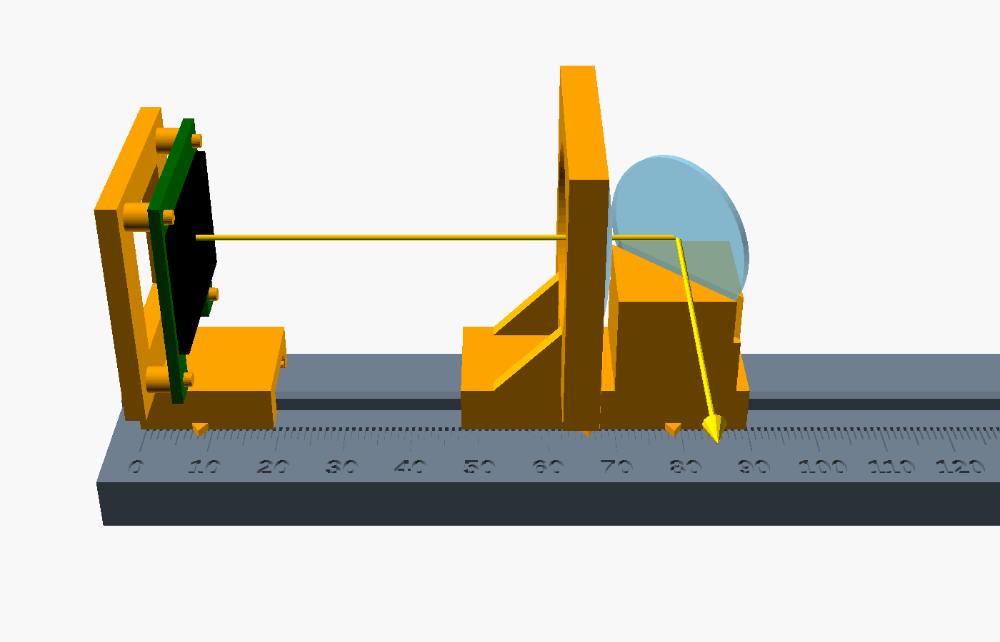
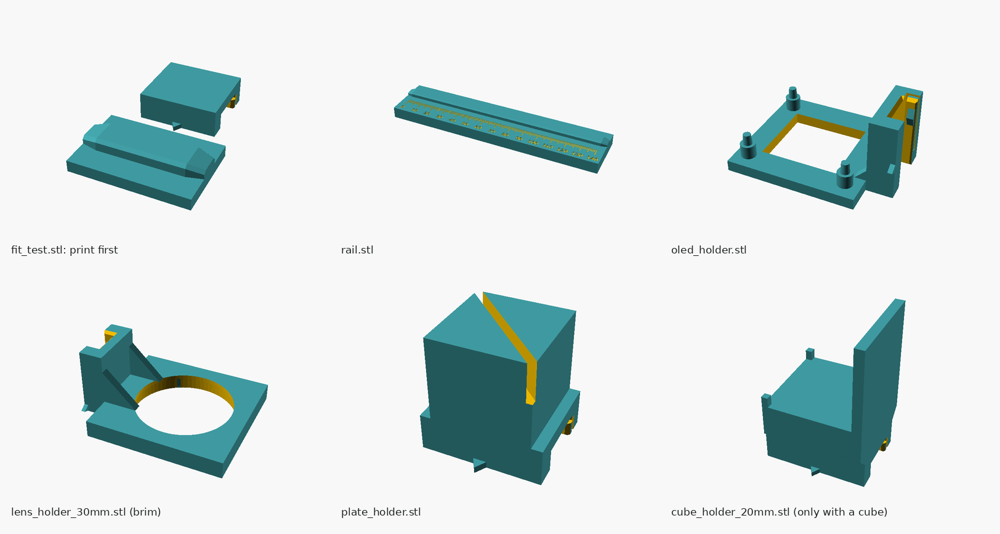
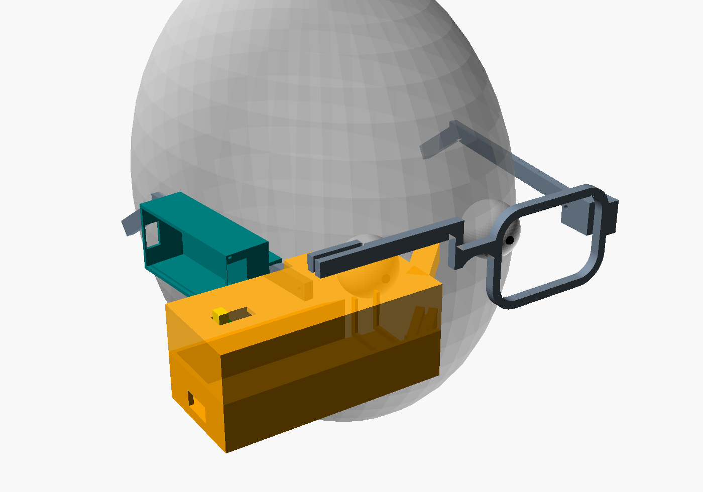
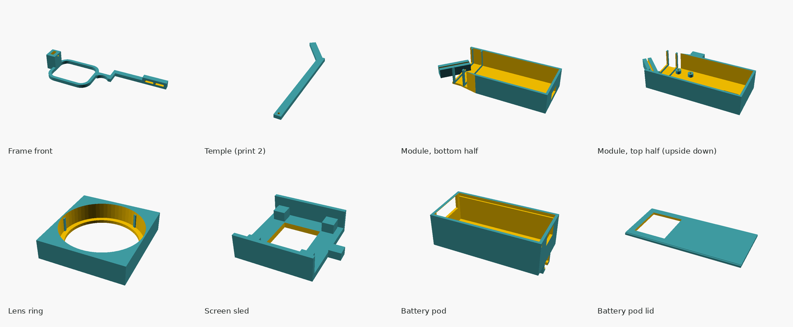

# 3D-printed parts

Models are written in [OpenSCAD](https://openscad.org), so every size is a number at the top of the file. If something doesn't fit, change the number and export again.

## Optics bench (print this first)

A rail with a millimeter scale and sliding holders for the screen, the lens and the beam splitter. You slide the holders until the floating text is sharp, then read the distances off the scale. Those numbers decide the size of the module that goes on the glasses.

The yellow line is the light: from the screen, through the lens, into the beam splitter, then out the front toward your eye. Each holder has a pointer over the scale:

| Holder | Its pointer marks |
|---|---|
| Screen holder | the screen's surface |
| Lens holder | the middle of the lens |
| Splitter holder (plate or cube) | the center of the splitter, where the light turns |

### What to print

All files in [`stl/`](stl) are already lying the right way for printing. **No supports needed.**

| File | Notes |
|---|---|
| `fit_test.stl` | **Print first.** A short rail and a bare holder base to check the sliding fit (see below) |
| `rail.stl` | 150 mm long, fits a 180 mm bed |
| `oled_holder.stl` | For the Adafruit 0.96" OLED (29.2 × 26.7 mm board) |
| `lens_holder_30mm.stl` | For the recommended 30 mm lens. Holders for 20, 25 and 34 mm lenses are there too; print one per lens you want to try |
| `plate_holder.stl` | Holds a flat splitter at 45°: the recommended 25 mm round plate, a microscope slide or clear plastic (up to 1.2 mm thick) |
| `cube_holder_15mm.stl` | Only if you have a 15 mm beam splitter cube. Print it in black if you can: its back wall soaks up stray light |

**Settings:** PLA or PETG, 0.2 mm layers (0.16 mm makes the scale numbers crisper), 3 walls, 15–20% infill. All the parts together use roughly 50 g of filament.

**Make the scale easy to read:** either add a filament color change at **7.4 mm** height when slicing the rail, or rub a fine marker over the engraved ticks and wipe the surface clean.

### Check the fit first

Print `fit_test.stl` and slide the small block onto the short rail; the ends of the ridge are tapered to help it on. Each holder has a small spring finger inside its groove that grips the ridge.

- **Just right:** slides with a gentle push and stays put when you let go.
- **Too tight:** in OpenSCAD, raise `clearance` from 0.25 to 0.3 and export the parts again (or sand the ridge lightly).
- **Too loose:** raise `press` from 0.3 to 0.45.

### Put it together

1. Slide the screen holder, lens holder and splitter holder onto the rail in that order, pointers on the side with the scale.
2. **Screen:** press the OLED into its holder face out. The small lips on the side brackets click over the board's edges. The cable leaves through the open side.
3. **Lens:** press it into the holder from the side with the wide opening; three thin ribs grip it. If one side of the lens is flat, put the flat side toward the screen.
4. **Splitter:** stand the plate in its slot. (A cube sits on its little table; turn it until the screen's light comes out toward the scale side, where your eye goes.)

Then follow the steps in [docs/optics.md](../docs/optics.md).

### Different parts?

Open `optics_bench.scad` in OpenSCAD and show **Window → Customizer**. Enter your measurements (screen board size, lens diameter, cube size, flat splitter thickness), pick a part, press **F6**, then **File → Export → Export as STL**. The `assembly` part is a preview of everything together.

## Glasses (draft v1)

`glasses.scad` is a first full design: a printed frame with the display module in place of the right lens, and a battery pod on the right temple. It's sized from the optics calculator (30 mm lens with a 60 mm focal length, 25 mm round plate splitter 25 mm in front of your pupil). **Treat it as a draft:** run the optics bench first, put your numbers and face measurements into the Customizer, then print.

### What it's like

- The light path stays straight: screen → lens → splitter → eye. The path is about 71 mm, so the module sticks out about 45 mm past the side of your head, Google Glass style.
- Everything together weighs roughly 80 g, about three times a normal pair of glasses. Fine for testing, too heavy for all day.
- A slimmer v2 would fold the light with small mirrors and use the bare OLED panel without its circuit board. That's worth doing once v1 proves the optics.

### Parts

All files are in [`stl/glasses/`](stl/glasses), already lying the right way to print. No supports needed.

| File | Notes |
|---|---|
| `frame.stl` | Left rim, bridge, and the brow bar that bolts onto the module |
| `temple.stl` | Print two. It's 181 mm long, so on a 180 mm bed, turn it diagonally |
| `module_lower.stl`, `module_upper.stl` | The display module's two halves. The top half prints upside down |
| `lens_ring.stl` | Holds the 30 mm lens with three grip ribs |
| `screen_sled.stl` | Holds the OLED and slides inside the module for focus |
| `pod_body.stl`, `pod_lid.stl` | Feather + battery case that slides onto the right temple |

You also need two M2 × 8 screws (brow bar to module), and two M2 × 10 screws or 2 mm pins (temples).

### Measure first

In the Customizer, set:
- **Your face:** pupil distance (an optician or a phone app can measure it), frame width, temple length
- **Optics:** the screen-to-lens and lens-to-splitter distances from the bench, and your lens's diameter and thickness
- **Splitter:** the module holds a 25 mm round plate up to about 1.4 mm thick. A rectangular plate (like 35 × 25 mm) needs a change to the module, so ask before printing.

### Put it together

1. **Lens:** press it into the lens ring from the open side, flat side last (the flat side faces the screen). Set the ring between the two ribs in the bottom half.
2. **Splitter:** stand the plate's lower edge in the groove of the bottom half's angled bracket.
3. **Screen:** press the OLED onto the sled's corner posts, face toward the lens. Run the cable out through the sled's window and the slot in the end wall. Set the sled in the far end.
4. **Close:** put the top half on, so the plate's upper edge goes into its groove. For testing, hold the halves together with tape or two small rubber bands; glue them once everything is right. Use epoxy, not super glue: its fumes can fog the lens and splitter.
5. **Frame:** screw the brow bar onto the module through its two slots. Slide it until the splitter sits right in front of your pupil, then tighten.
6. **Temples:** slide each temple's tongue into its socket and push a pin or screw through the hole.
7. **Pod:** put the battery in, the Feather on top, and slide the lid in. Slide the pod onto the right temple from the back.
8. **Focus:** with the demo firmware running, slide the tab on top of the module until the text is sharp.
