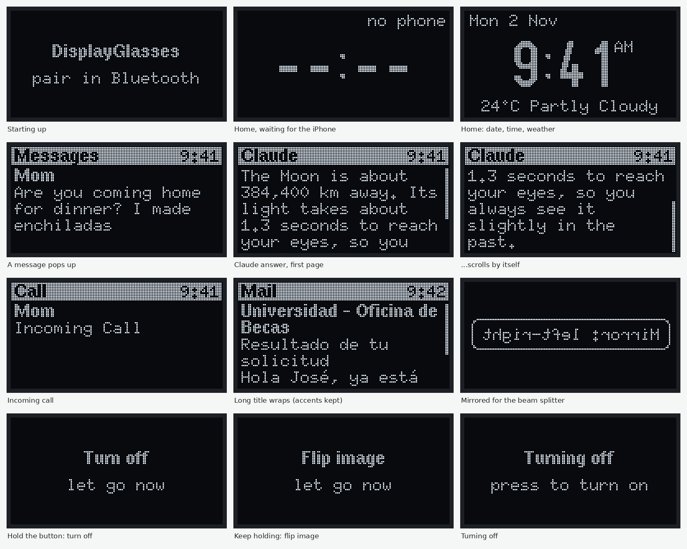

# Screen simulator

Runs the real screen code from the firmware (`firmware/src/hud.cpp` and `firmware/lib/core`) on your computer and saves every frame it would send to the OLED. It uses the same U8g2 graphics library and fonts as the glasses, so the pictures match the real screen pixel for pixel. Only the hardware parts (I2C, the clock) are swapped for stand-ins in `fake/`.



## Run it

You need a C/C++ compiler, Python 3 with Pillow (`pip install pillow`), and one firmware build so PlatformIO has downloaded U8g2:

```bash
cd firmware && pio run -e feather_demo && cd ..
```

```bash
tools/hudsim/build.sh
```

```bash
build/hudsim/hudsim build/hudsim/frames.jsonl
```

```bash
python3 tools/hudsim/render.py build/hudsim/frames.jsonl docs/images/screens
```

That writes `overview.png` (the main screens with captions), `demo.gif` (demo mode playing at double speed) and every single frame to `all/`. GitHub builds these on every push and publishes them on the project site.

## Screen tests

`hud_test.cpp` checks the screen's behavior by looking at the actual pixels: a call disappears when it ends, the queue keeps the newest eight messages, long answers scroll and close, toasts clear, text never runs off the screen, the mirror mode is an exact mirror, the messages shown while you hold the button stay until you let go, the screen turns off before sleep, and the clock redraws when the time changes.

```bash
tools/hudsim/build.sh --test
```

## Add a scene

Scenes live in `sim_main.cpp`. Send the HUD a notification with `onNotification(...)`, let virtual time pass with `run(hud, milliseconds)`, and every new frame is recorded. It's the quickest way to check how a new screen or a long message will look before flashing the glasses.
